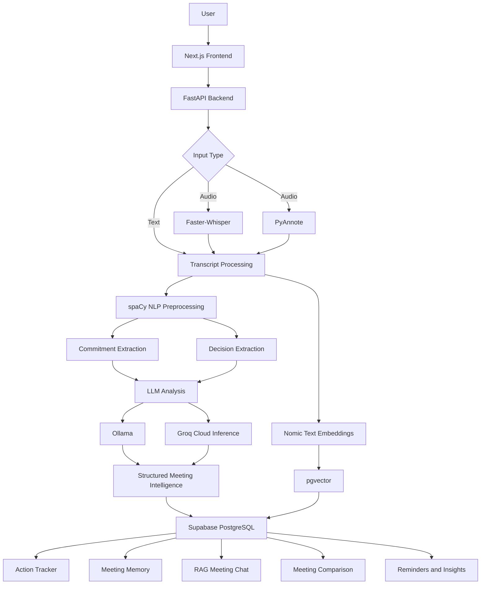
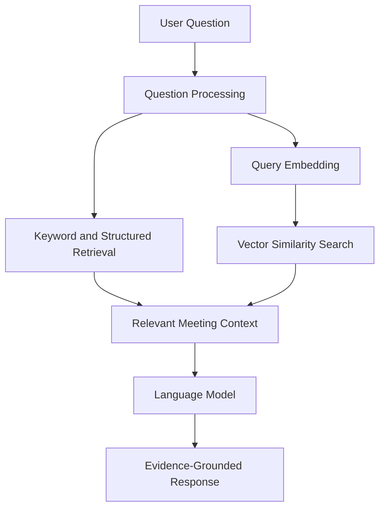
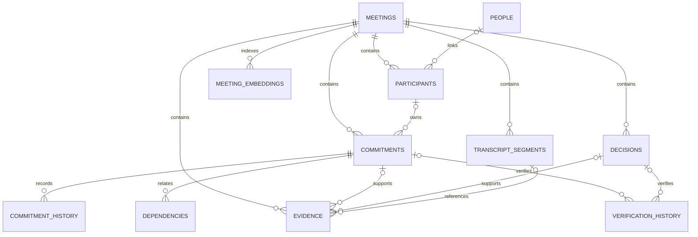

# Meeting Intelligence & Accountability System

An AI-powered meeting analysis and accountability platform that transforms meeting recordings and transcripts into structured, evidence-backed and actionable intelligence.

Developed as part of the IMDAI (CSET-225) academic project at Bennett University.

---

## Table of Contents

- Project Overview
- Problem Statement
- Objectives
- Key Features
- System Architecture
- Technology Stack
- AI/ML Models
- NLP Techniques
- Meeting Processing Pipeline
- Semantic Search and RAG
- Hybrid AI Inference
- Application Modules
- Database Architecture
- Project Structure
- API Modules
- Installation and Setup
- Environment Configuration
- Running the Application
- Testing
- Security and Privacy
- Limitations
- Future Scope
- Team Members

---

## 1. Project Overview

Meeting Intelligence is a full-stack AI application designed to improve meeting productivity, organizational memory and individual accountability.

Traditional meeting applications mainly provide recordings and transcripts. However, users must manually identify important decisions, assigned responsibilities, deadlines and unresolved issues.

Meeting Intelligence addresses this problem by combining speech recognition, speaker diarization, natural language processing, pretrained language models, semantic embeddings and structured database operations.

The system is designed to convert unstructured meeting conversations into meaningful information that can be searched, analyzed, verified and tracked across multiple meetings.

## 2. Problem Statement

Organizations conduct multiple meetings involving discussions, decisions, commitments and task assignments.

Important information can become difficult to retrieve because it is distributed across recordings, transcripts, emails and meeting notes.

Common problems include:

- Missing or forgotten commitments.
- Unclear task ownership.
- Missed deadlines.
- Difficulty retrieving previous decisions.
- Lack of accountability.
- Repeated discussions across meetings.
- Manual preparation of meeting summaries.
- Difficulty tracking changes between meetings.

The proposed system provides a centralized platform for extracting, organizing and retrieving meeting intelligence.

## 3. Project Objectives

- Convert meeting recordings into timestamped transcripts.
- Identify different speakers in meeting conversations.
- Apply NLP techniques to understand meeting transcripts.
- Extract decisions, commitments, owners and deadlines.
- Maintain evidence for extracted information.
- Enable semantic and keyword-based meeting search.
- Provide conversational access to meeting information.
- Track individual responsibilities across meetings.
- Compare related meetings and identify changes.
- Generate meeting follow-up drafts.
- Provide reminders and accountability insights.
- Support human verification of AI-generated information.

## 4. Key Features

| Feature | Description |
|---|---|
| Meeting Management | Create and manage meeting records |
| Audio Transcription | Convert meeting recordings into text |
| Transcript Upload | Analyze directly uploaded meeting transcripts |
| Speaker Diarization | Distinguish different speakers |
| NLP Preprocessing | Linguistic analysis of meeting conversations |
| Decision Extraction | Identify important meeting decisions |
| Commitment Extraction | Identify assigned responsibilities |
| Evidence Tracking | Associate extracted information with transcript evidence |
| Action Tracker | Track tasks assigned to individuals |
| Meeting Memory | Search historical meeting information |
| AI Meeting Chat | Ask natural-language questions about meetings |
| Meeting Comparison | Compare decisions and commitments across meetings |
| AI Follow-ups | Generate meeting follow-up drafts |
| People Management | Link participants across multiple meetings |
| Reminders | Track upcoming and overdue commitments |
| Insights | Analyze accountability and task statistics |
| Human Verification | Review AI-extracted decisions and commitments |

The presence of a feature in the implementation does not imply that every end-to-end scenario has been fully validated.

## 5. System Architecture



## 6. Technology Stack

### Frontend

- Next.js
- React
- TypeScript
- CSS
- REST API integration

### Backend

- Python
- FastAPI
- Pydantic
- SQLAlchemy
- Uvicorn
- Alembic

### Database

- Supabase
- PostgreSQL
- pgvector

### Artificial Intelligence and NLP

- Faster-Whisper
- PyAnnote Audio
- spaCy
- Nomic Embed Text
- Qwen3
- Llama 3.2
- Ollama
- Groq inference integration
- Retrieval-Augmented Generation
- Cosine similarity

### Development Tools

- Git
- GitHub
- Visual Studio Code
- Python virtual environments
- npm

## 7. AI/ML Models

| Model | Architecture or Approach | Application |
|---|---|---|
| Whisper | Encoder-decoder Transformer | Automatic speech recognition |
| spaCy en_core_web_sm | CNN-based linguistic pipeline | NLP preprocessing |
| Nomic Embed Text | Encoder-only Transformer | Semantic embeddings |
| Qwen3 4B | Decoder-only Transformer | Meeting analysis and reasoning |
| Llama 3.2 3B | Decoder-only Transformer | Conversational question answering |
| PyAnnote | Neural speaker diarization | Speaker separation |

The project integrates pretrained models rather than training large neural networks from scratch.

Exact checkpoints and inference parameters depend on the application configuration.

### 7.1 Faster-Whisper

Faster-Whisper provides efficient speech recognition using pretrained Whisper models.

Its responsibilities include:

- Processing meeting audio.
- Converting speech into text.
- Generating transcript timestamps.
- Preparing transcript segments for NLP analysis.

Implementation:

`backend/app/services/transcription_service.py`

### 7.2 PyAnnote Audio

PyAnnote is used for speaker diarization.

Speaker diarization identifies when different speakers are speaking in an audio recording.

Speaker labels can be associated with transcript segments using their timestamps.

Diarization alone does not identify the real-world names of speakers.

Implementation:

`backend/app/services/diarization_service.py`

### 7.3 spaCy

The spaCy NLP pipeline provides linguistic information that supports structured information extraction.

Its applications include tokenization, sentence segmentation, lemmatization, named entity recognition, part-of-speech tagging and dependency parsing.

Implementation:

`backend/app/services/nlp_preprocessing_service.py`

### 7.4 Nomic Embed Text

Nomic Embed Text converts textual information into numerical embeddings.

The project uses 768-dimensional vectors for semantic retrieval.

These embeddings allow the application to identify related information even when the exact words differ.

Implementation:

`backend/app/services/embedding_service.py`

### 7.5 Qwen3 4B

Qwen3 is a pretrained language model used for contextual meeting analysis.

Its applications include:

- Meeting summarization.
- Decision extraction.
- Commitment validation.
- Contextual reasoning.
- Structured information generation.

Implementation:

`backend/app/services/llm_service.py`

`backend/app/services/analysis_service.py`

### 7.6 Llama 3.2 3B

Llama 3.2 3B provides a lightweight local language model option for conversational responses.

The model can answer meeting-related questions using retrieved context and conversation history.

Implementation:

`backend/app/services/meeting_chat_service.py`

`backend/app/services/llm_service.py`

## 8. NLP Techniques

| Technique | Purpose |
|---|---|
| Tokenization | Split text into linguistic tokens |
| Sentence Segmentation | Identify sentence boundaries |
| Lemmatization | Obtain base forms of words |
| POS Tagging | Identify grammatical word categories |
| Named Entity Recognition | Identify people, organizations, dates and other entities |
| Dependency Parsing | Understand grammatical relationships |
| Rule-Based Extraction | Identify potential decisions and commitments |
| Information Extraction | Extract structured meeting information |
| Text Embeddings | Represent text numerically |
| Cosine Similarity | Measure semantic similarity |
| Semantic Search | Retrieve information based on meaning |
| Keyword Search | Retrieve exact textual matches |
| Text Summarization | Generate concise meeting summaries |
| Question Answering | Answer questions about meetings |
| Text Generation | Generate conversational responses and follow-up drafts |
| Contextual Reasoning | Interpret meeting discussions |
| RAG | Ground generated answers in retrieved information |

Transformer architectures and attention mechanisms are used internally by the pretrained language and embedding models.

The project does not implement Transformer training from scratch.

## 9. Meeting Processing Pipeline

### Stage 1: Meeting Input

The user creates a meeting and provides an audio recording or textual transcript.

### Stage 2: Speech Processing

Audio recordings can be processed through speech recognition and speaker diarization services.

Direct transcript uploads can bypass audio processing.

### Stage 3: NLP Preprocessing

The transcript is processed using linguistic analysis to identify sentence boundaries, entities, grammatical relationships and potential actions.

### Stage 4: Candidate Extraction

Dedicated NLP services identify potential commitments and decisions.

Implementation:

- `nlp_commitment_extraction.py`
- `nlp_decision_extraction.py`

### Stage 5: Contextual Analysis

Language model inference provides contextual interpretation and structured meeting analysis.

### Stage 6: Structured Storage

Meeting information is stored in PostgreSQL, including decisions, commitments, participants and supporting evidence.

### Stage 7: Semantic Indexing

Text embeddings support historical meeting retrieval through pgvector.

### Stage 8: Accountability

Stored information supports action tracking, reminders, insights, verification and meeting comparison.

## 10. Semantic Search and RAG

Retrieval-Augmented Generation combines information retrieval with language model generation.

Instead of relying exclusively on the language model's pretrained knowledge, the application retrieves relevant meeting information and provides it as context.



### Cosine Similarity

Cosine similarity measures the relationship between two vectors.

It is calculated as the dot product of the vectors divided by the product of their magnitudes.

Higher similarity generally indicates more closely related semantic representations.

### Example

Stored transcript:

"Priya will fix the authentication bug."

User question:

"Who is responsible for resolving login issues?"

Semantic retrieval can identify the relevant transcript even though the question uses different wording.

## 11. Hybrid AI Inference

The application supports local AI inference through Ollama and includes integration for cloud inference through Groq.

### Ollama

- Runs supported language models locally.
- Supports local meeting analysis.
- Provides conversational inference.
- Generates text embeddings.
- Reduces dependence on external language model APIs.

### Groq

- Provides cloud-based model inference.
- Can improve response speed.
- Requires valid API credentials.
- Depends on internet connectivity and provider availability.

Groq is an inference platform, not a standalone language model.

Cloud processing should only be enabled when meeting data is permitted to leave the local environment.

Provider selection, fallback behavior and model identifiers depend on the configured implementation.

## 12. Application Modules

### Dashboard

Provides an overview of meetings, commitments and accountability information.

### Meeting Management

Supports creating meetings, uploading transcripts or recordings and viewing meeting analysis.

### Action Tracker

Organizes commitments by individual participants and meeting records.

Supports task status, ownership, deadlines and accountability tracking.

### Meeting Memory

Provides keyword and semantic retrieval of historical meeting information.

### AI Meeting Chat

Allows users to ask natural-language questions about meeting discussions, decisions and responsibilities.

The chat service combines retrieved information with language model inference.

### Meeting Comparison

Compares related meetings to identify changes in decisions and commitments.

The comparison can identify new responsibilities, changed deadlines, pending commitments and information not mentioned in subsequent meetings.

A task not mentioned in a later meeting should not automatically be considered completed.

### AI Follow-ups

Provides meeting follow-up draft generation.

Actual email delivery requires a separately configured email integration.

### People Management

Maintains shared person identities and links participants across meetings.

### Reminders

Supports meeting-specific and deadline-based reminders.

### Insights

Provides accountability information and task-related statistics.

### Human Verification

Allows users to review extracted decisions and commitments.

Verification history helps maintain transparency regarding changes to AI-generated information.

## 13. Database Architecture

The application uses Supabase PostgreSQL with pgvector support.

| Table | Purpose |
|---|---|
| meetings | Meeting information and processing status |
| participants | Meeting-specific participant records |
| people | Shared person identities |
| transcript_segments | Timestamped transcript segments |
| decisions | Extracted meeting decisions |
| commitments | Tasks, owners, deadlines and status |
| dependencies | Relationships between commitments |
| evidence | Supporting transcript evidence |
| commitment_history | Commitment change history |
| verification_history | Human verification records |
| meeting_embeddings | Semantic text vectors |
| alembic_version | Database migration tracking |

### Entity Relationship Diagram



## 14. Project Structure

```text
meeting-intelligence/
├── backend/
│   ├── app/
│   │   ├── api/
│   │   │   ├── accountability.py
│   │   │   ├── analysis.py
│   │   │   ├── commitments.py
│   │   │   ├── comparison.py
│   │   │   ├── decisions.py
│   │   │   ├── evidence.py
│   │   │   ├── followups.py
│   │   │   ├── insights.py
│   │   │   ├── meeting_chat.py
│   │   │   ├── meeting_relationships.py
│   │   │   ├── meetings.py
│   │   │   ├── memory.py
│   │   │   ├── participants.py
│   │   │   ├── people.py
│   │   │   ├── reminders.py
│   │   │   ├── role_insights.py
│   │   │   ├── transcript_search.py
│   │   │   ├── transcript_upload.py
│   │   │   ├── transcription.py
│   │   │   └── verification.py
│   │   ├── core/
│   │   │   └── config.py
│   │   ├── db/
│   │   ├── models/
│   │   ├── schemas/
│   │   ├── services/
│   │   │   ├── accountability_service.py
│   │   │   ├── analysis_service.py
│   │   │   ├── commitment_service.py
│   │   │   ├── decision_service.py
│   │   │   ├── diarization_service.py
│   │   │   ├── embedding_service.py
│   │   │   ├── evidence_service.py
│   │   │   ├── file_service.py
│   │   │   ├── followup_service.py
│   │   │   ├── llm_service.py
│   │   │   ├── meeting_chat_service.py
│   │   │   ├── meeting_relationship_service.py
│   │   │   ├── meeting_service.py
│   │   │   ├── memory_service.py
│   │   │   ├── nlp_commitment_extraction.py
│   │   │   ├── nlp_decision_extraction.py
│   │   │   ├── nlp_preprocessing_service.py
│   │   │   ├── owner_resolution_service.py
│   │   │   ├── participant_service.py
│   │   │   ├── person_insights_service.py
│   │   │   ├── reminder_service.py
│   │   │   ├── role_insights_service.py
│   │   │   ├── transcription_service.py
│   │   │   └── verification_service.py
│   │   ├── utils/
│   │   └── main.py
│   ├── requirements.txt
│   └── .env.example
├── frontend/
│   ├── app/
│   │   ├── actions/
│   │   ├── chat/
│   │   ├── components/
│   │   ├── followups/
│   │   │   └── compare/
│   │   ├── insights/
│   │   ├── meetings/
│   │   ├── memory/
│   │   ├── people/
│   │   ├── reminders/
│   │   ├── globals.css
│   │   ├── layout.tsx
│   │   └── page.tsx
│   └── package.json
└── README.md
```

The tree highlights the principal application source files.

## 15. API Modules

| Module | Responsibility |
|---|---|
| meetings | Meeting management |
| transcription | Audio transcription |
| transcript_upload | Direct transcript processing |
| analysis | Meeting intelligence extraction |
| decisions | Decision management |
| commitments | Commitment management |
| participants | Meeting participants |
| people | Shared person identities |
| evidence | Supporting evidence |
| memory | Semantic retrieval |
| transcript_search | Keyword transcript retrieval |
| meeting_chat | Conversational AI |
| comparison | Cross-meeting comparison |
| meeting_relationships | Related meeting information |
| followups | Follow-up generation |
| accountability | Responsibility tracking |
| reminders | Deadline reminders |
| insights | Accountability analytics |
| role_insights | Role-based insights |
| verification | Human verification |

Interactive API documentation is available through FastAPI Swagger UI.

- Swagger: http://127.0.0.1:8000/docs
- OpenAPI: http://127.0.0.1:8000/openapi.json
- ReDoc: http://127.0.0.1:8000/redoc

The OpenAPI specification provides the actual endpoint paths, HTTP methods and request schemas.

## 16. Installation and Setup

### Prerequisites

- Git
- Python 3.12 recommended
- Node.js compatible with the frontend dependencies
- npm
- Ollama
- PostgreSQL or Supabase database
- pgvector extension
- FFmpeg where required for audio processing
- Hugging Face access for gated diarization models
- Groq API credentials for optional cloud inference

### Clone the Repository

```bash
git clone https://github.com/katlarupchand18/meeting-intelligence.git
cd meeting-intelligence
```

### Backend Setup

```bash
cd backend

python3.12 -m venv venv

source venv/bin/activate

python -m pip install --upgrade pip

python -m pip install -r requirements.txt

python -m spacy download en_core_web_sm

python -m pip check
```

For Windows PowerShell, activate the environment using:

```powershell
.\venv\Scripts\Activate.ps1
```

### Install Local AI Models

Install Ollama from https://ollama.com.

Download the required models:

```bash
ollama pull qwen3:4b

ollama pull llama3.2:3b

ollama pull nomic-embed-text
```

Verify installed models:

```bash
ollama list
```

### Frontend Setup

From the repository root:

```bash
cd frontend

npm ci
```

## 17. Environment Configuration

Create the backend environment file using the provided example:

```bash
cd backend

cp .env.example .env
```

Configure the required values according to:

`backend/app/core/config.py`

Configuration categories include:

| Configuration | Purpose |
|---|---|
| Database connection | PostgreSQL or Supabase access |
| Ollama URL | Local model inference |
| Analysis model | Meeting analysis |
| Fast chat model | Conversational inference |
| Embedding model | Semantic vector generation |
| Groq credentials | Optional cloud inference |
| Hugging Face credentials | Optional diarization model access |
| Provider settings | AI provider selection |

Do not commit real environment files.

### Database Setup

Create a PostgreSQL or Supabase database and enable pgvector:

```sql
CREATE EXTENSION IF NOT EXISTS vector;
```

Configure the database connection string in the backend environment file.

Inspect the available Alembic migrations before applying them:

```bash
alembic current

alembic heads
```

For a properly configured database, apply the required migrations using:

```bash
alembic upgrade head
```

Back up existing databases before running schema migrations. Do not reset or delete existing meeting records.

## 18. Running the Application

### Terminal 1: Ollama

```bash
ollama serve
```

Skip this command if Ollama is already running.

### Terminal 2: Backend

```bash
cd backend

source venv/bin/activate

python -m uvicorn app.main:app \
  --host 127.0.0.1 \
  --port 8000
```

### Terminal 3: Frontend

```bash
cd frontend

npm run dev -- --port 3001
```

### Application URLs

| Service | URL |
|---|---|
| Frontend | http://localhost:3001 |
| Backend | http://127.0.0.1:8000 |
| Swagger API | http://127.0.0.1:8000/docs |
| Ollama | http://127.0.0.1:11434 |

## 19. Example Meeting Transcript

```text
Rahul: We have decided to postpone the production
launch until November 30.

Priya: I will fix the authentication bug by
November 27 at 5 PM.

Arjun: I will integrate the updated authentication
API by November 28.

Sneha: I will complete security testing by
November 29.

Rahul: The launch will proceed after successful
security testing and QA approval.
```

### Expected Analysis

- Decision: Postpone the production launch.
- Commitment: Fix the authentication bug.
- Owner: Priya.
- Deadline: November 27 at 5 PM.
- Commitment: Integrate the updated authentication API.
- Owner: Arjun.
- Commitment: Complete security testing.
- Owner: Sneha.
- Dependency: Launch depends on successful testing and QA approval.

This is an illustrative expected result, not a measured model evaluation.

## 20. Testing and Validation

### Backend Dependency Check

```bash
python -m pip check
```

### Python Syntax Check

From the backend directory:

```bash
python -m compileall -q app
```

### Backend Tests

If pytest and the project test suite are installed:

```bash
python -m pytest -q
```

### OpenAPI Verification

```bash
curl -I http://127.0.0.1:8000/docs

curl -f http://127.0.0.1:8000/openapi.json
```

### Frontend Type Checking

```bash
npx tsc --noEmit
```

### Frontend Production Build

```bash
npm run build
```

### Functional Testing

Recommended validation scenarios:

- Meeting creation.
- Transcript upload.
- Audio decoding and transcription.
- Speaker diarization.
- Decision extraction.
- Commitment extraction.
- Owner and deadline resolution.
- Semantic search.
- AI meeting chat.
- Cross-meeting comparison.
- Follow-up draft generation.
- Individual action tracking.
- Reminder generation.
- Human verification.

No standardized accuracy, latency or production-readiness claim is made without measured evaluation.

## 21. Troubleshooting

### Ollama Connection Failure

Verify that Ollama is running:

```bash
ollama list

curl http://127.0.0.1:11434/api/tags
```

### spaCy Model Missing

```bash
python -m spacy download en_core_web_sm
```

### Faster-Whisper Audio Decoding Error

A compatibility issue involving PyAV and Faster-Whisper was identified during development.

PyAV 16.0.1 successfully resolved the standalone audio decoding issue in the development environment.

If the same compatibility error occurs, inspect the installed versions and project requirements before changing dependencies.

```bash
python -m pip show av faster-whisper

python -m pip check
```

Successful audio decoding alone does not establish complete transcription or diarization success.

### Port Already in Use

```bash
lsof -i :8000

lsof -i :3001
```

Stop only the appropriate development process before restarting the application.

### Swagger Loading Failure

Inspect backend logs and verify OpenAPI generation:

```bash
python -c "from app.main import app; app.openapi(); print('OpenAPI OK')"
```

### Groq Inference Failure

Check the configured model identifier, API credentials, internet connection and provider rate limits.

Never print API credentials in logs or share them publicly.

## 22. Security and Privacy

The application handles potentially sensitive meeting information.

Recommended security practices:

- Store credentials in environment variables.
- Never commit API keys or database passwords.
- Never expose backend secrets to the frontend.
- Exclude private recordings and transcripts from GitHub.
- Validate uploaded files and API requests.
- Review AI-generated information before accepting important decisions.
- Restrict database access appropriately.
- Obtain permission before recording meetings.
- Obtain authorization before sending meeting data to cloud inference providers.
- Maintain secure database backups.

Local model inference can reduce external processing of meeting content. However, a cloud-hosted database or cloud inference provider introduces additional privacy considerations.

Production authentication, authorization and security controls require separate validation.

## 23. Current Limitations

- Pretrained models may produce incorrect or incomplete information.
- NLP rules may identify false commitment or decision candidates.
- Audio quality affects transcription performance.
- Overlapping speech can reduce diarization accuracy.
- Anonymous speaker labels require additional identity resolution.
- Local inference speed depends on available hardware.
- Cloud inference depends on network access and provider limits.
- Semantic search quality depends on embedding quality and retrieval settings.
- Cross-meeting comparisons require reliable participant and commitment relationships.
- Actual email delivery requires additional configuration.
- Full end-to-end validation of recently integrated components remains necessary.

## 24. Future Scope

- Improved multilingual meeting analysis.
- Real-time transcription.
- Real-time meeting assistance.
- Advanced speaker identification.
- Improved commitment and decision classification.
- Fine-tuning specialized NLP models.
- Automated evaluation datasets.
- Calendar integration.
- Authorized email delivery.
- Enterprise authentication and access control.
- Advanced organizational analytics.
- Improved retrieval ranking.
- Mobile application support.
- Scalable cloud deployment.

## 25. Team Members

| Name | Enrollment Number |
|---|---|
| Yash Singh | S24CSEU2682 |
| Rupchand Katla | S24CSEU2700 |
| Piyush Dagar | S24CSEU2680 |

**University:** Bennett University

**School:** School of Computer Science Engineering and Technology

**Course:** IMDAI — CSET-225

**Academic Project:** Meeting Intelligence: An AI-Powered Meeting Analysis and Accountability System

## 26. References

- FastAPI: https://fastapi.tiangolo.com/
- Next.js: https://nextjs.org/docs
- spaCy: https://spacy.io/
- Faster-Whisper: https://github.com/SYSTRAN/faster-whisper
- PyAnnote Audio: https://github.com/pyannote/pyannote-audio
- Ollama: https://ollama.com/
- Nomic Embed Text: https://ollama.com/library/nomic-embed-text
- Qwen3: https://ollama.com/library/qwen3
- Llama 3.2: https://ollama.com/library/llama3.2
- Groq: https://console.groq.com/docs
- Supabase: https://supabase.com/docs
- PostgreSQL: https://www.postgresql.org/docs/
- pgvector: https://github.com/pgvector/pgvector
- SQLAlchemy: https://docs.sqlalchemy.org/
- Alembic: https://alembic.sqlalchemy.org/

---

Developed as an academic AI and NLP project at Bennett University.